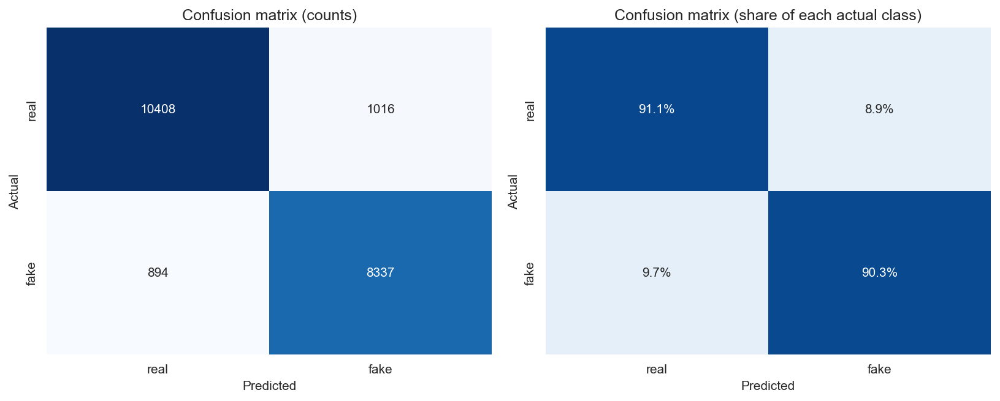
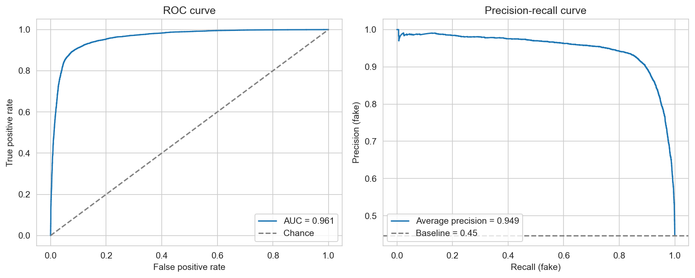
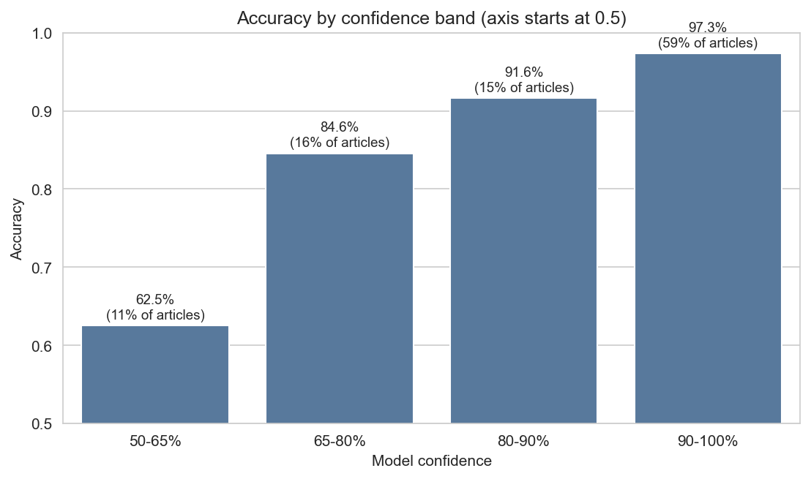
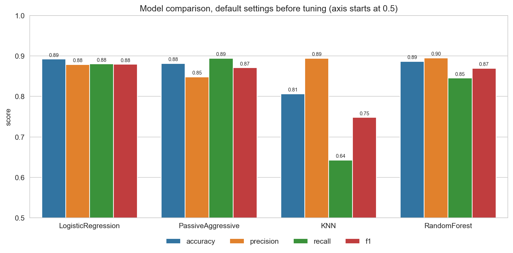
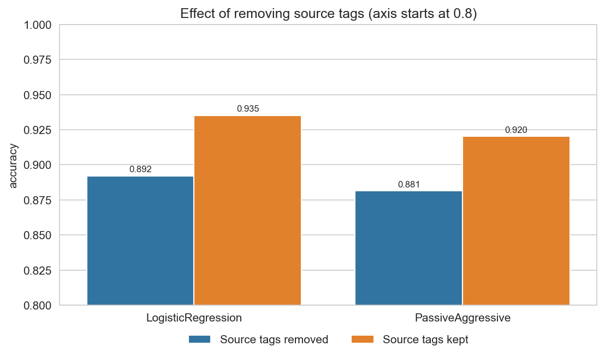
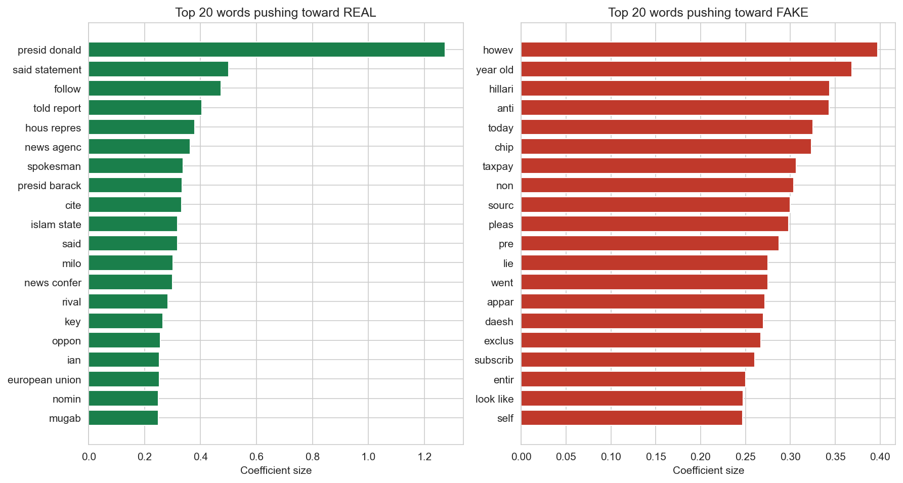

# Evaluation report

Test set: 20,655 articles (variant `stripped`). Positive class = fake.

## Final model metrics

| accuracy | precision | recall | f1 | f1_macro | roc_auc | avg_precision |
|---|---|---|---|---|---|---|
| 0.9075 | 0.8914 | 0.9032 | 0.8972 | 0.9066 | 0.9608 | 0.9488 |

## Per-class report

| class | precision | recall | f1-score | support |
|---|---|---|---|---|
| real | 0.9209 | 0.9111 | 0.9160 | 11424.0000 |
| fake | 0.8914 | 0.9032 | 0.8972 | 9231.0000 |
| accuracy | 0.9075 | 0.9075 | 0.9075 | 0.9075 |
| macro avg | 0.9061 | 0.9071 | 0.9066 | 20655.0000 |
| weighted avg | 0.9077 | 0.9075 | 0.9076 | 20655.0000 |

## Accuracy by confidence

| band | articles | accuracy | share_of_test |
|---|---|---|---|
| 50-65% | 2222 | 0.6251 | 0.1076 |
| 65-80% | 3237 | 0.8455 | 0.1567 |
| 80-90% | 3019 | 0.9162 | 0.1462 |
| 90-100% | 12177 | 0.9734 | 0.5895 |

Giving a verdict only when the fake probability is <= 35% or >= 65% covers 89.2% of articles at 94.16% accuracy.

## Model comparison

| model | accuracy | precision | recall | f1 | f1_macro | seconds |
|---|---|---|---|---|---|---|
| LogisticRegression | 0.8921 | 0.8787 | 0.8802 | 0.8794 | 0.8909 | 69.3000 |
| PassiveAggressive | 0.8814 | 0.8485 | 0.8943 | 0.8708 | 0.8806 | 67.9000 |
| KNN | 0.8064 | 0.8942 | 0.6428 | 0.7479 | 0.7954 | 137.1000 |
| RandomForest | 0.8866 | 0.8951 | 0.8452 | 0.8695 | 0.8846 | 113.4000 |

## Effect of source tags

| model | variant | accuracy | f1 |
|---|---|---|---|
| LogisticRegression | Source tags removed | 0.8921 | 0.8794 |
| PassiveAggressive | Source tags removed | 0.8814 | 0.8708 |
| LogisticRegression | Source tags kept | 0.9352 | 0.9276 |
| PassiveAggressive | Source tags kept | 0.9203 | 0.9108 |

## Most influential words

